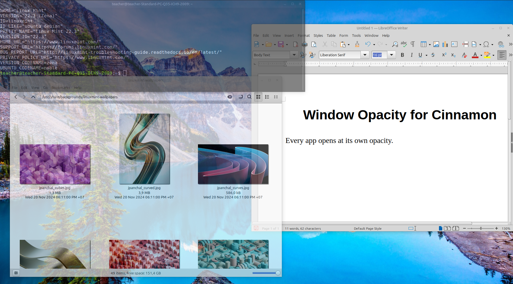
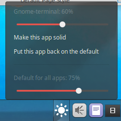

# Window Opacity for Cinnamon

A small panel applet for the Cinnamon desktop (Linux Mint and others) that makes your windows see-through.



- **Every app opens at a default opacity** (75% out of the box). New windows get it automatically, not just the ones already open.
- **Per-app settings are remembered.** Set Nemo to 85% once and every Nemo window opens at 85% from then on, even after a reboot.
- **One click to adjust.** Click the panel icon on your panel for two sliders: one for the app you last used, one for the default.
- **Scroll on the icon** to change the current app in 5% steps.
- **Fullscreen games and videos stay solid**, and so do hidden helper windows (like desktop widgets or live wallpapers).
- Never goes below 20%, so nothing disappears.

## Install

```bash
git clone https://github.com/ChadXSO/cinnamon-window-opacity.git
cd cinnamon-window-opacity
./install.sh
```

The panel icon shows up on the right side of your first panel (usually the bottom bar). You can move it like any other applet with the panel's edit mode.

## Use it



1. Click a window so it's the active one.
2. Click the panel icon.
3. Drag the top slider for that app, or the bottom slider for the default for every app.

Menu options:

- **Make this app solid**: that app always opens at 100%.
- **Put this app back on the default**: forget the app's own setting.

## Uninstall

```bash
./uninstall.sh
```

All windows go back to solid.

## How it works

Cinnamon ignores the usual X11 opacity hint (`_NET_WM_WINDOW_OPACITY`, the one `transset` sets) for most windows. This applet uses Cinnamon's own window opacity (`Meta.Window.set_opacity`), which works on every app and keeps the windows underneath visible. It reapplies the setting whenever a window opens or is unminimized. Settings are kept by window class through Cinnamon's own applet settings, and the default can also be changed from the applet's Configure dialog.

## Notes

- Tested on Linux Mint (Cinnamon, X11).
- Separate opacity for the title bar isn't supported. Cinnamon draws the title bar and the window as one image.

## License

MIT
